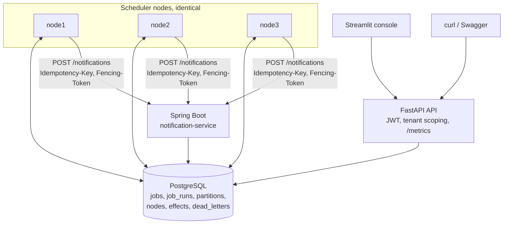
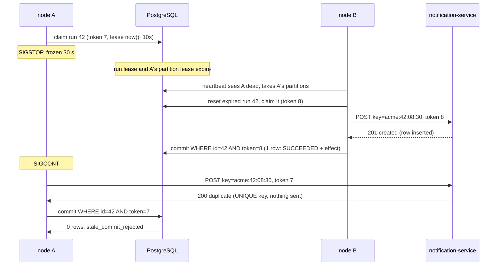

# Design note: distributed trip job scheduler

## 1. Problem and guarantee

Hundreds of thousands of trip jobs (pickup alerts, rosters, no-show cancels, billing) must
fire on time across a cluster of at least three nodes, survive crashes and pauses, and never
lose a job or duplicate its business effect.

**Exactly-once *execution* is impossible in general.** A node can perform a side effect
(send an SMS) and die before recording that it did. No other node can tell whether the
effect happened, so it must either retry (possible duplicate) or not (possible loss). The
same holds for a node that is merely paused: it cannot know it was paused.

**What this system guarantees: at-least-once execution + exactly-once *effect*.**

- Every firing is a `job_runs` row that is retried until it is committed, so nothing is lost.
- Every firing carries an idempotency key `tenant_id:job_id:scheduled_at`, reused by every
  retry and takeover. The effect store enforces it with a UNIQUE constraint, so a repeated
  attempt is detected and suppressed.
- Every write back to the scheduler is fenced by a monotonically increasing token, so a node
  that lost ownership cannot overwrite a newer owner's result.

## 2. Architecture

Each node runs four async loops:

| Loop | Every | Does |
|---|---|---|
| membership | 2 s | heartbeat; compute desired partitions by rendezvous hashing over live nodes; take/renew those partition leases (10 s); release the rest |
| materializer | 5 s | for cron jobs in owned partitions, create `job_runs` up to 60 s ahead in the tenant's time zone, applying DST and misfire rules |
| dispatcher | 0.1 s | reset expired runs; split free capacity fairly across tenants; claim due runs with `FOR UPDATE SKIP LOCKED`, new fencing token each |
| executor | per run | run handler with max-runtime timeout; renew run leases in one batched UPDATE; fenced commit or fenced retry/dead-letter |

**Why PostgreSQL is the coordinator.** It is the durable job store anyway, its row locks
and `SKIP LOCKED` give contention-free claiming, and its `now()` is a single clock for every
due-time and lease decision (node clocks are never compared). This avoids a second moving
part (ZooKeeper/etcd/Redis) for a 3-node cluster. Trade-off: the database is the scaling
ceiling and a single point of failure (mitigated in production by a managed HA Postgres).

**No single hot lock.** There are 32 partitions (`job_id % 32`). Each node only scans and
claims inside the partitions it leases, and partition leases are 32 independent rows that
change only on membership changes. Rendezvous hashing means a joining or leaving node moves
only its own share of partitions. Partition ownership is for spreading load; *safety does
not depend on it*: if two nodes briefly believe they own a partition, the row-level claim
still hands each run to one node and fencing still rejects stale writes.

## 3. The hardest flow: a node freezes mid-run (SIGSTOP)

Measured in `tests/failure/sigstop.sh`: the frozen node held 186 in-flight alerts, the other
nodes finished all of them while it was frozen, and on waking all 186 of its writes were
rejected; 600 alerts, 600 notifications, 600 distinct keys.

## 4. Scheduling rules

**Time zones.** Cron is evaluated in the job's zone (default: the tenant's). "0 22 * * *"
for a Bengaluru tenant fires at 16:30 UTC; for a New York tenant at 02:00 or 03:00 UTC
depending on DST. Instants are stored in UTC.

**DST.**
- *Gap* (02:30 does not exist on spring-forward day): fire once at the first valid wall-clock
  minute after the gap (03:00). Several cron times inside one gap collapse into that firing.
- *Overlap* (01:30 happens twice on fall-back day): fire once, on the first occurrence.

**Misfires** (a firing more than 60 s late: cluster down, tenant paused, backlog):
- `FIRE_NOW` runs every late firing as soon as possible (catch-up capped at 100 per job).
- `SKIP` drops late firings and continues from the next on-time one.
- `COALESCE` collapses all late firings of a job into one run (the most recent).
Applied both when cron firings are materialized and when an already-materialized run is
claimed late.

**Retries.** Failure or timeout → `RETRY_WAIT` after `random(0, min(60, 2^(attempt-1)))` s
(full jitter, so retries from one outage do not stampede). After `max_attempts` (default 5)
→ `DEAD` plus a `dead_letters` row; operators inspect and replay it. Replay reuses the run and
its idempotency key, so it cannot duplicate an effect that did happen.

**Fairness.** Each tenant has a concurrency cap (default 50). Each dispatch round, a node's
free capacity is water-filled across tenants with due work: equal shares, and what a small
tenant does not need goes to the others. With 50,000 alerts for tenant A and 20 for tenant B
at 08:00, B's 20 are claimed in the first round (`tests/test_fairness.py`).

## 5. Failure modes

| Failure | User impact | Detection and recovery |
|---|---|---|
| Node crash (kill -9) | Its in-flight alerts are delayed ~10-15 s | Heartbeat stops (dead after 6 s); partition and run leases expire (10 s); survivors take the partitions, reset expired runs, re-claim with new tokens. Measured: 200 in flight, 1,200/1,200 delivered once, 15 s |
| Node frozen (SIGSTOP, GC pause, VM stall) | Same delay; no duplicate | As above; on wake its renewals, commits and failure writes are rejected by fencing token; its duplicate send is suppressed by the idempotency key |
| Crash after side effect, before commit | None | Run is retried by another node; notification-service returns "duplicate"; run commits |
| Handler hangs | That run delayed up to max runtime | `max_runtime_s` timeout → retry with backoff |
| Downstream (notification-service) down | Alerts delayed | Retries with backoff; after max attempts → dead letter, replayable |
| Whole cluster down | Firings late | On restart, misfire policy per job decides fire / skip / coalesce |
| Postgres down | Nothing fires; API returns 5xx | Nodes keep retrying their loops; leases resume after recovery; in production use HA Postgres |
| Network partition: node cut off from DB | Its runs delayed | Same as a freeze: it cannot renew, others take over, its writes are fenced |
| Clock skew between nodes | None | All due-time and lease comparisons use the DB clock `now()` |
| Tenant floods 50k jobs | Other tenants unaffected | Per-tenant cap + fair allocation |
| Duplicate or out-of-order write from an old owner | None | Older fencing token: update matches 0 rows, logged as `stale_commit_rejected` |
| Duplicate API submission | Two jobs | Not deduplicated at the API (see trade-offs) |

**Takeover timing.** After a crash, a run is re-claimed once its 10 s run lease has expired
and its partition has moved: about lease + 2 s detection. In the kill -9 test, the last of
1,200 alerts finished 14 s after the kill, including 3 s of simulated send time.

**Duplicate and out-of-order messages.** A duplicate send (retry, takeover, replay) carries
the same idempotency key and is suppressed. A late, out-of-order write from an old owner
carries an older fencing token and is rejected, whatever order it arrives in.

## 6. Code structure (OOP and layering)

- **Controllers** (`app/api/*`): HTTP, validation and auth only.
- **Services** (`app/services/*`): `JobService`, `TenantService`, `OpsService` hold the
  business rules and raise domain errors (`NotFoundError`, `ConflictError`); no HTTP, no SQL.
- **Repository** (`app/repository.py`): all SQL in one place.
- **Core** (`app/core/*`): pure algorithms (cron + DST, misfire, backoff, rendezvous
  hashing, fair allocation), unit-tested without a web server or database.
- **Polymorphism:** `JobHandler` is an abstract base class; each job type (`pickup_alert`,
  `roster`, `billing`, `no_show`, `noop`, `flaky`) is a subclass, and the executor only
  knows the base class. In Java, `NotificationSender` is an interface with a
  `LogNotificationSender` implementation, behind a controller → service → repository stack.
- **Encapsulation:** each node loop is a class owning its state (`Membership` hides
  partition validity behind `owned`; `Executor` owns the in-flight set and lease renewal).

## 7. Security and data handling

- JWT (HS256), three roles, every endpoint tenant-scoped:

  | Role | Scope | Can |
  |---|---|---|
  | admin | all tenants | everything, create tenants, see the cluster |
  | operator | own tenant | create/trigger jobs, pause/resume, replay dead letters, read |
  | employee | own tenant | read only: jobs, runs, next fire times, stats |

  Tenant isolation is enforced in the controllers and tested (`tests/test_api_security.py`).
- **Errors never leak:** every error is `{"error": code, "message": text}`. Validation
  errors list field names and messages but never echo submitted values. Unexpected
  errors return a generic message plus a request id; details go to the logs only.
- Logs are JSON and pass through a PII scrubber; handlers log ids only, never names,
  phone numbers or addresses. The Spring sender logs tenant, trip id, token and node only.
- Secrets come from environment variables (`.env`, not committed).

## 8. Caching and staleness

| Cached | Where | Eviction | What can be stale | Bound |
|---|---|---|---|---|
| Tenant config (paused flag, concurrency cap) | each node's dispatcher, in memory | TTL 2 s (`TENANT_CACHE_TTL_S`), full reload | a paused tenant may still be dispatched; a changed cap applies late | ≤ 2 s after the change |
| Partition ownership | each node's `Membership` | refreshed every 2 s; treated as empty 8 s after the last successful renewal | a node may scan a partition it just lost | safe anyway: row-level claim + fencing |

Nothing that decides correctness is cached: due times, run ownership and fencing tokens
are always read from the database.

## 9. Monitoring

Each node exposes Prometheus metrics on :9100: `scheduler_fire_lag_seconds` (histogram),
claimed/succeeded/failed (by outcome) counters, `scheduler_stale_commits_rejected_total`,
`scheduler_leases_lost_total`, `scheduler_runs_reclaimed_total`, `scheduler_misfire_skipped_total`,
in-flight and owned-partition gauges. The API's `/metrics` adds cluster-wide gauges from the
database: runs by status, running, retrying, dead letters, **queue depth** (due but unclaimed),
**oldest due age**, **error rate** (last 10 min) and fire-lag p50/p95/p99. At 3 AM, a rising
queue depth or oldest-due age says the cluster is falling behind; rising stale rejections or
reclaims say nodes are crashing or pausing.

## 10. Cost: time, space and where it stops scaling

Notation: D = runs due now in a node's partitions, T = tenants with due work, B = claim
batch (100), k = runs in flight on a node (≤ 200), P = partitions (32), N = nodes.

| Operation | Time | Notes |
|---|---|---|
| Claim, per tenant per tick | O(d_t log B) | index range scan on (tenant, next_attempt_at) + top-B sort; `SKIP LOCKED`, no waiting |
| Due count per tick | O(D) | partial index on due rows only |
| Fair allocation | O(T) per round, ≤ T rounds | pure Python; T is tens |
| Fenced commit | O(log n) | primary-key update + one insert, one transaction |
| Lease renewal | O(k log n) | one UPDATE for all in-flight runs |
| Partition assignment | O(P · N) hashes | 96 SHA-1s per heartbeat for 3 nodes |
| Cron materialization | O(firings in horizon) | DST gap resolution ≤ 60 one-minute steps |

**Space:** a `job_runs` row is about 250 B, about 600 B with its five indexes; an `effects`
row about 150 B. 100,000 runs/day is about 75 MB/day, so finished runs need archiving
(not built). A node holds O(k) in-flight tasks in memory.

**Measured:** 100,000 jobs over 10 minutes on 3 nodes: p50 31 ms, p99 118 ms, max 245 ms,
166 jobs/s (the full offered load), 0 duplicates; machine details in the README.
**Where it stops scaling:** the single Postgres primary. Every run costs three writes (claim,
commit, effect) plus WAL, so a laptop-class database tops out around a few thousand runs/s,
and connections cap the cluster at about 12 nodes (20 per node, `max_connections=300`). Under
a large backlog the per-tick due count grows linearly. Next steps, in order: batch commits,
PgBouncer, time-partitioned `job_runs`, then sharding partitions across several databases.

## 11. Trade-offs and what I would do next

- **Consistency over availability:** if Postgres is unreachable, nothing fires rather than
  risking duplicates. Latency is bought with polling (100 ms dispatcher tick), not with
  weaker guarantees.

- **Postgres as coordinator** instead of etcd/ZooKeeper: fewer moving parts, one clock;
  the DB is the ceiling. Next: read replicas for the API, partitioned `job_runs` tables,
  archiving finished runs.
- **Soft per-tenant cap across nodes:** two nodes may read the same running count at the
  same instant and briefly exceed the cap by a few runs. A hard cap would need a counter row
  per tenant, which is exactly the hot lock we avoided.
- **Tenant config cached for 2 s:** pause takes effect within 2 s.
- **Fixed 32 partitions:** enough for tens of nodes; changing the count needs a migration.
- **Effect store per side-effect owner:** local effects use the `effects` table inside the
  commit transaction; external effects (notifications) dedupe in their own service. Any new
  external integration must accept an idempotency key.
- **Python for the scheduler, Spring Boot for the notification service:** delivery speed for
  the core in the language I know best; the side-effect service is in the preferred stack and
  shows idempotency across a service boundary.
- **Not built:** API-level request idempotency, Prometheus/Grafana containers (metrics are
  exposed), multi-region.
